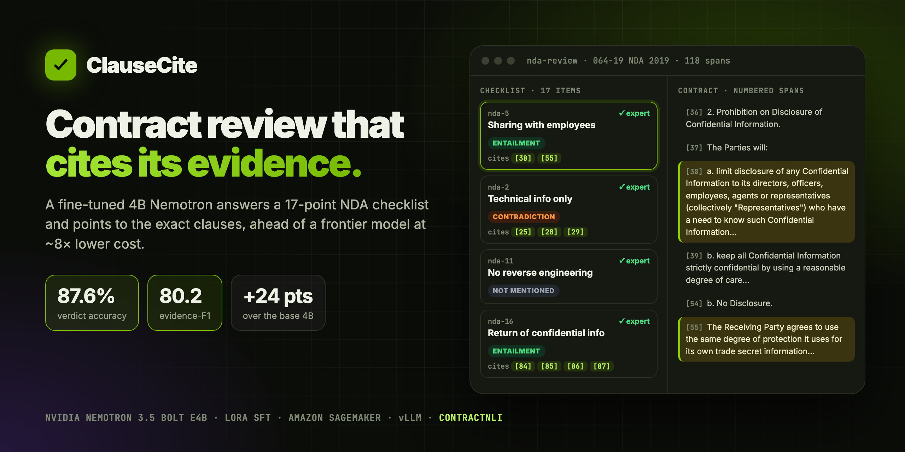
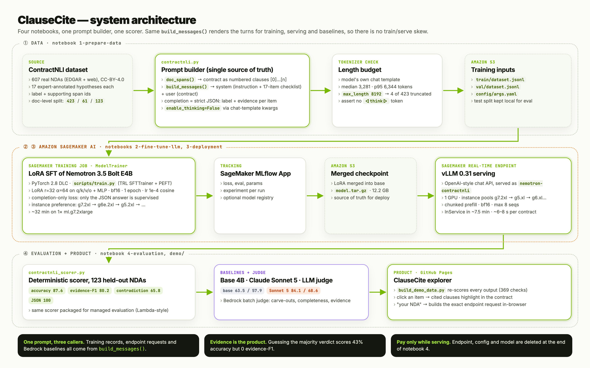
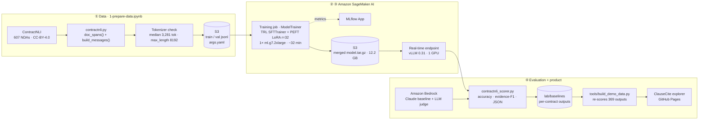

<div align="center">



# ClauseCite

**NDA review that cites its evidence. A fine-tuned 4B Nemotron model answers a 17-point legal checklist, points to the exact clauses, and beats a frontier model on this task.**

[](https://vnmoorthy.github.io/nda-review-nemotron/)
[](https://github.com/vnmoorthy/nda-review-nemotron/actions/workflows/ci.yml)
[](LICENSE)
[](https://huggingface.co/nvidia)
[](https://aws.amazon.com/sagemaker/)

[**Live demo**](https://vnmoorthy.github.io/nda-review-nemotron/) · [Pitch deck (.pptx)](docs/ClauseCite-pitch-deck.pptx) · [Results](#-results) · [Architecture](#-architecture) · [Quickstart](#-quickstart) · [How it works](#-how-it-works) · [FAQ](#-faq)

</div>

---

## Why this exists

A verdict alone is useless to a lawyer. *"Item 5 fails"* gives a reviewer nothing to act on. *"Item 5 fails, see clause 38"* can be checked in seconds.

ClauseCite reviews a non-disclosure agreement against a **fixed 17-point legal checklist**. For every item it returns a verdict (`Entailment`, `Contradiction` or `NotMentioned`) **and the clause numbers that justify it**. The citations are what make the output reviewable. They are also the part that can't be faked: always answering the most common verdict gets **43% accuracy and exactly 0 evidence-F1**.

This shape of task covers far more than NDAs: **a fixed checklist, applied over and over to one type of document, with a verdict plus a pointer to the evidence.** Change the checklist and the documents, and the same pipeline does vendor security reviews, insurance claims, regulatory filing checks, clinical-trial screening or RFP compliance.

## ✨ Highlights

- 🎯 **87.6% verdict accuracy, 80.2 evidence-F1** on 123 held-out NDAs (2,091 decisions). That's **+3.5 accuracy and +11.6 evidence-F1 over Claude Sonnet 5 zero-shot**.
- 🪶 **A 4B model on one GPU.** LoRA SFT of NVIDIA Nemotron 3.5 Bolt E4B in **~32 minutes** on a single `ml.g7.2xlarge`, served with vLLM, at **~8× lower cost per contract** than the frontier API (figure from the source lab).
- 🧾 **100% valid structured output**: strict JSON with one entry per checklist item, every time.
- 🔁 **Zero train/serve skew by construction.** One function, `build_messages()`, produces the turns for training, serving and the baselines.
- 🔬 **Results you can check yourself.** A build script re-scores every saved model output (369 checks) and fails if any number drifts. CI runs it on every push.
- 🖥️ **[Interactive explorer](https://vnmoorthy.github.io/nda-review-nemotron/)**: open any of the 123 test contracts, click a checklist item, and see the model's cited clauses next to the expert's.

## 📊 Results

Held-out ContractNLI test split: **123 contracts × 17 checklist items = 2,091 decisions**, none seen in training.

| Model | Accuracy | Evidence-F1 | Contradiction accuracy | Valid JSON |
|---|---:|---:|---:|---:|
| Nemotron 3.5 Bolt E4B, untuned | 63.5 | 57.9 | 57.5 | 94.3 |
| Claude Sonnet 5, zero-shot | 84.1 | 68.6 | 62.3 | 100.0 |
| **Nemotron 3.5 Bolt E4B + LoRA SFT (this repo)** | **87.6** | **80.2** | **65.8** | **100.0** |
| ↳ independent re-run of the pipeline (Nov 2026) | 87.5 | 81.0 | 66.8 | 100.0 |

<sub>Accuracy = share of the 17 verdicts that match the expert. Evidence-F1 = overlap between cited and expert clause sets, on items where the expert cites something. Contradiction accuracy = accuracy on the rare (≈10%) Contradiction class. The base and Sonnet rows use the same prompt via the model's chat template and Amazon Bedrock respectively. Sources: `lab/baselines/*.json`; the re-run is from executing all four notebooks end to end.</sub>

**An LLM judge agrees.** A Claude Sonnet 4.5 judge on Amazon Bedrock, scoring 30 contracts on three rubric metrics (pre-computed reference, `lab/baselines/judge_reference_metrics.json`):

| Rubric metric | Base | Fine-tuned |
|---|---:|---:|
| ChecklistCompleteness | 0.100 | **1.000** |
| EvidenceSupportsVerdict | 0.578 | **0.778** |
| CarveOutHandling | 0.333 | **0.567** |

**Where it still fails.** The most common confusions are *NotMentioned → Entailment* and *NotMentioned → Contradiction*: the model claims a contract addresses an item when it is actually silent. That's the failure that matters most in compliance work, and it's the first thing to improve (see [Roadmap](#-roadmap)).

## 🏗 Architecture





| Stage | Where | What happens | Key detail |
|---|---|---|---|
| **1 · Prepare** | `lab/1-prepare-data.ipynb` | Download ContractNLI, number each contract's clauses, render chat turns, measure tokens, upload to S3 | Reasoning is switched off with the chat template's `enable_thinking=False` flag. This model ignores a `/no_think` string in the prompt. |
| **2 · Fine-tune** | `lab/2-fine-tune-llm.ipynb`, `lab/scripts/train.py` | SageMaker Training Job runs TRL `SFTTrainer` with PEFT LoRA, then merges the adapter | Completion-only loss: the contract is context, and only the JSON answer is supervised. A list of preferred instance types handles GPU capacity. |
| **3 · Deploy** | `lab/3-deployment.ipynb` | Merged checkpoint → SageMaker real-time endpoint on the vLLM DLC | The endpoint config lists several instance types so deployment survives capacity shortages; a smoke test checks 17/17 keys. |
| **4 · Evaluate** | `lab/4-evaluation.ipynb` | Scores all 123 test contracts concurrently, compares against base and frontier, optional Bedrock judge, then deletes the endpoint | Same scorer used locally and as a managed-evaluation function. |
| **Product** | `demo/`, `tools/` | Static explorer of every test contract + "run on your NDA" request builder | Every number shown is recomputed from raw model output when the site is built. |

## 🚀 Quickstart

### 0 · Try it without any setup
Open the **[live demo](https://vnmoorthy.github.io/nda-review-nemotron/)**. Sort by *"Biggest win vs frontier"*, pick a contract, and click a checklist item.

### 1 · Run the demo locally (no AWS needed)
```bash
git clone https://github.com/vnmoorthy/nda-review-nemotron && cd nda-review-nemotron
python3 -m http.server 8000 --directory demo   # then open http://localhost:8000
```

### 2 · Reproduce the numbers from raw outputs
```bash
mkdir -p data && curl -sSL -o data/cn.zip https://stanfordnlp.github.io/contract-nli/resources/contract-nli.zip \
  && unzip -q data/cn.zip -d data && rm data/cn.zip
python3 tools/build_demo_data.py        # re-scores 123 × 3 model outputs, asserts every score
pip install pytest && pytest -q tests   # scorer + data checks
node tests/test_prompt_parity.mjs       # browser prompt == training prompt, byte for byte
```

### 3 · Train and deploy your own (Amazon SageMaker AI)
**Requirements:** a SageMaker Studio JupyterLab space; an execution role with SageMaker, S3 and (optionally) Bedrock access; quota for one GPU training instance and one GPU endpoint instance from the lists in notebooks 2 and 3.

```bash
git clone https://github.com/vnmoorthy/nda-review-nemotron && cd nda-review-nemotron/lab
```
Then run the notebooks in order, using **Run → Run All Cells** for each:

| Notebook | Time | What you get |
|---|---|---|
| `1-prepare-data.ipynb` | ~2 min | train/val data in your default S3 bucket |
| `2-fine-tune-llm.ipynb` | ~35 min | a completed training job and `model.tar.gz` |
| `3-deployment.ipynb` | ~8 min | an InService vLLM endpoint and a passing smoke test |
| `4-evaluation.ipynb` | ~3 min | scores on all 123 test contracts, then **automatic cleanup** |

In `4-evaluation.ipynb`, set `RUN_ENDPOINT_EVAL = True` to score **your** endpoint (the default reads the pre-computed reference). Set `RUN_JUDGE_EVAL = True` to also run the Bedrock judge (~20 min, billed by Bedrock).

> 💸 **Cost control.** The endpoint bills per instance-hour while it exists. Notebook 4's last cell deletes the endpoint, its config and the model. If you stop early, run that cell anyway.

### 4 · Call the endpoint from your app
```python
import json, boto3, sys
sys.path.insert(0, "lab")
import contractnli as C

C.ensure_dataset("./data"); docs, labels = C.load("test")
runtime = boto3.client("sagemaker-runtime")
body = {"model": "nemotron-contractnli", "messages": C.build_messages(docs[0], labels),
        "max_tokens": 700, "temperature": 0, "chat_template_kwargs": C.CHAT_TEMPLATE_KWARGS}
r = runtime.invoke_endpoint(EndpointName="NVIDIA-Nemotron-3-5-Bolt-E4B-BF16-contractnli-sft-ep",
                            ContentType="application/json", Body=json.dumps(body))
print(json.loads(r["Body"].read())["choices"][0]["message"]["content"])
```
For your own NDA, paste it into the demo's **"Run it on your own NDA"** box. It splits the text into numbered spans in your browser and generates this exact request.

## 🧠 How it works

**The input.** One request is a system turn (instruction + the 17-item checklist, an identical 3,234 characters in every record) and a user turn (the contract as numbered spans `[0] … [n]`). The whole contract is always sent, because any clause can decide any item.

**The output.** Strict JSON with one key per checklist item:
```json
{"nda-5": {"label": "Contradiction", "evidence": [3]},
 "nda-4": {"label": "Entailment",    "evidence": [4]},
 "nda-11": {"label": "NotMentioned", "evidence": []}, "...": "17 keys total"}
```

**Why fine-tune instead of prompting?** In the source lab's measurements, adding worked examples to the prompt made the small model *worse*, and the untuned model doesn't reliably produce valid JSON (94.3% here, far lower with a naive prompt). The fine-tune fixes the output format, learns the label boundaries (especially carve-outs, as in *"may share with employees **who need to know**"*), and learns which clauses a lawyer would actually cite.

**Training recipe** (`lab/2-fine-tune-llm.ipynb` → `args.yaml`)

| Setting | Value |
|---|---|
| Base model | `nvidia/NVIDIA-Nemotron-3.5-Bolt-E4B-BF16` |
| Method | LoRA SFT (PEFT), adapter merged into the weights after training |
| LoRA | r = 32, α = 64, dropout 0.05, on q/k/v/o + gate/up/down of the language model |
| Data | 423 contracts, `prompt_completion` format, completion-only loss |
| Schedule | 1 epoch, lr 1e-4 cosine, 10% warmup, grad-accum 4, bf16, gradient checkpointing |
| Context | `max_length` 8192 (4 of 423 records truncated, none dropped) |
| Hardware | 1× `ml.g7.2xlarge` (preference list falls back to g6e/g5/g6), ~32 min |

**Serving.** SageMaker vLLM 0.31 DLC on one GPU. The checklist's flag `enable_thinking=False` is sent in every request through `chat_template_kwargs`, exactly as during training.

## 📁 Repository layout

```
nda-review-nemotron/
├── demo/                      # the product: static explorer (GitHub Pages)
│   ├── index.html             #   single-file app, no build step
│   └── data/                  #   123 contracts + 3 models' parsed outputs + scores
├── lab/                       # the full train → deploy → evaluate pipeline
│   ├── 1-prepare-data.ipynb
│   ├── 2-fine-tune-llm.ipynb
│   ├── 3-deployment.ipynb
│   ├── 4-evaluation.ipynb
│   ├── contractnli.py         #   data access + build_messages(): one prompt for every caller
│   ├── contractnli_scorer.py  #   deterministic scorer (also a managed-eval function)
│   ├── evaluation_utils.py    #   endpoint scoring, baselines, Bedrock judge, plots
│   ├── inference_performance.py
│   ├── config.py              #   model id, S3 prefixes, MLflow settings
│   ├── scripts/train.py       #   TRL + PEFT training entry point (runs in the DLC)
│   └── baselines/             #   per-contract outputs: base, Claude Sonnet 5, fine-tuned
├── tools/build_demo_data.py   # rebuilds demo/data and asserts every score reproduces
├── tests/                     # pytest (scorer, data) + node (prompt parity)
├── docs/assets/               # hero image, architecture diagram (+ HTML sources)
└── .github/workflows/         # CI + GitHub Pages deploy
```

## 🗺 Roadmap

- [ ] **Cut false positives on silent contracts.** Add negative-focused examples and a calibrated "abstain" threshold for `NotMentioned`.
- [ ] **Live inference mode for the demo.** A small API Gateway + Lambda proxy to a scale-to-zero endpoint.
- [ ] **New checklists:** vendor security questionnaires, DPAs, SOWs. Same pipeline, different `labels`.
- [ ] **Clause-level confidence** from token log-probs, shown as a heat strip in the explorer.
- [ ] **PDF/DOCX ingestion** with layout-aware span numbering.

## ❓ FAQ

<details><summary><b>Is this legal advice?</b></summary>
No. It is a research and engineering demo. Its purpose is to make a reviewer faster by pointing at clauses, not to replace the reviewer.
</details>

<details><summary><b>Are the demo outputs real?</b></summary>
Yes. They are the raw generations saved from each model on the 123 test contracts (<code>lab/baselines/*_rows.json</code>), parsed and scored by <code>tools/build_demo_data.py</code>. The fine-tuned outputs come from the lab's reference run (87.6 / 80.2). An independent end-to-end re-run of all four notebooks scored 87.5 / 81.0.
</details>

<details><summary><b>Why does the base model look better here than in some write-ups?</b></summary>
The untuned baseline here is served with the model's own chat template and reasoning switched off (63.5 accuracy). Run with a naive prompt, the same weights often never reach valid JSON and score far lower. The comparison in this repo is the fair one.
</details>

<details><summary><b>Can I use a different model?</b></summary>
Change <code>BASE_MODEL_ID</code> in <code>lab/config.py</code> and check the chat-template notes in notebooks 1 and 3. The scorer, data pipeline and demo don't depend on the model.
</details>

<details><summary><b>Does pasting my NDA into the demo upload it?</b></summary>
No. Span splitting and request building run entirely in your browser.
</details>

## 🙏 Acknowledgements

- Pipeline adapted from the **Amazon SageMaker AI workshop** [`aws-samples/generative-ai-on-amazon-sagemaker`](https://github.com/aws-samples/generative-ai-on-amazon-sagemaker) (`workshops/fine-tune-nvidia-nemotron-3-sagemaker-ai`, MIT-0). This repo adds the ClauseCite explorer, the reproducibility build and tests, the documentation, and an end-to-end re-run.
- **ContractNLI**, Yuta Koreeda & Christopher D. Manning, *Findings of EMNLP 2021*, CC-BY-4.0.
- **NVIDIA Nemotron** models, **Hugging Face TRL/PEFT**, and **vLLM**.

See [NOTICE.md](NOTICE.md) for license details.

## 📜 License

[MIT-0](LICENSE) for code. Dataset-derived content in `demo/data/` is CC-BY-4.0 (ContractNLI). If you use this, please cite it with [CITATION.cff](CITATION.cff).

<div align="center"><sub>If ClauseCite saved you time, a ⭐ helps others find it.</sub></div>
